# Deploying an Autoscaling App on Amazon EKS with Helm (Project 2 Rebuild)

I rebuilt my "Deploying Microservices on Amazon EKS" project from scratch to make sure I could do every step myself, explain why each piece exists, and debug it when something breaks. This write-up covers what I built, the exact commands I ran, the errors I hit and how I fixed them, and how I tore it all down so it stopped costing money.

**Stack:** Amazon EKS, eksctl, kubectl, Helm, metrics-server, Horizontal Pod Autoscaler (HPA), AWS CLI

---

## In plain English (for non-technical readers)

Imagine running a restaurant. You have **kitchens** (servers), **cooks** (copies of your app) working in them, and one **phone number** customers call to place orders, so they never need to know which cook is on shift.

In this project:

- **Amazon EKS** ran and managed the kitchens for me (2 servers in AWS).
- **Helm** was my reusable recipe card. One template, and I just change the details (like how many cooks) in a separate list.
- **The Service** was the phone number. Cooks come and go, but the number never changes.
- **The autoscaler** was a shift manager watching the orders. When I flooded the app with fake traffic, it called in more cooks (1 to 3). When the rush ended, it sent them home (back to 1). Nobody had to do it by hand.
- At the end, I **shut everything down** and confirmed with AWS that nothing was still charging me.

---

## Architecture

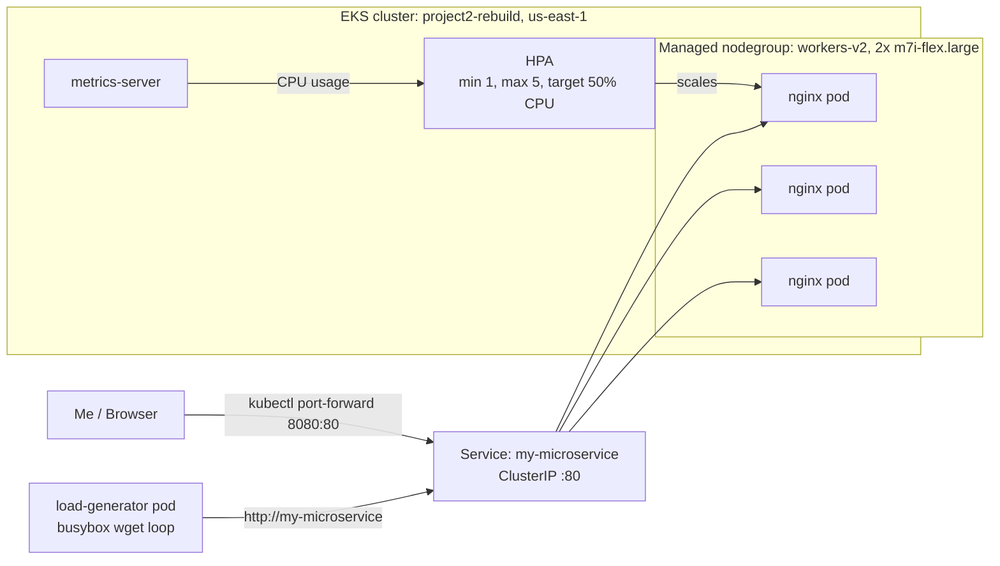

| Piece | What it does |
|---|---|
| EKS control plane | The "manager's office." Runs Kubernetes for me. |
| Nodegroup `workers-v2` | 2 EC2 worker nodes (m7i-flex.large) where pods actually run |
| Helm chart `my-microservice` | Templates + `values.yaml` that generate the Kubernetes YAML |
| Deployment | Keeps the requested number of nginx pods running |
| Service (ClusterIP) | Stable internal address in front of the pods |
| metrics-server | Measures pod CPU and memory |
| HPA | Adds or removes pods based on CPU vs. target |

---

## Prerequisites

- AWS account and AWS CLI configured (`aws configure`)
- `eksctl`, `kubectl`, and `helm` installed
- Region: `us-east-1`

Confirm which AWS identity you're using before building anything:

```bash
aws sts get-caller-identity
```

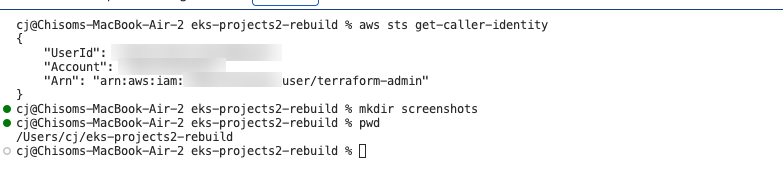

---

## Section 1: Create the cluster and connect to it

Check the tools first:

```bash
eksctl version
kubectl version --client
helm version
```

Create the cluster:

```bash
eksctl create cluster \
  --name project2-rebuild \
  --region us-east-1 \
  --nodegroup-name workers \
  --node-type t3.medium \
  --nodes 2 \
  --managed
```

> **Why eksctl:** one command builds the EKS control plane, the VPC and subnets, and the worker nodes using CloudFormation behind the scenes.

The original `workers` nodegroup (t3.medium) failed because my AWS account was on a tier that didn't allow that instance type. So I checked which instance types my account could actually launch:

```bash
eksctl get nodegroup --cluster project2-rebuild --region us-east-1

aws ec2 describe-instance-types \
  --filters Name=free-tier-eligible,Values=true \
  --query "InstanceTypes[].InstanceType" --region us-east-1
```

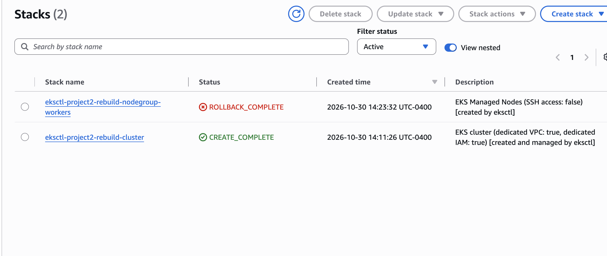

The stack events showed the real reason: `InvalidParameterCombination - The specified instance type is not eligible for Free Tier.`

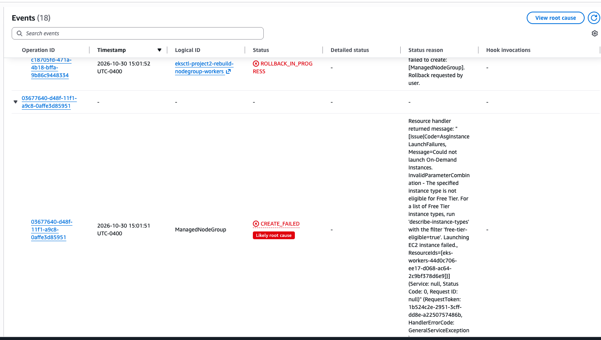

Then I added a new managed nodegroup with an eligible type. `caffeinate -i` keeps the Mac awake so the long create doesn't get interrupted:

```bash
caffeinate -i eksctl create nodegroup \
  --cluster project2-rebuild \
  --region us-east-1 \
  --name workers-v2 \
  --node-type m7i-flex.large \
  --nodes 2 \
  --managed
```

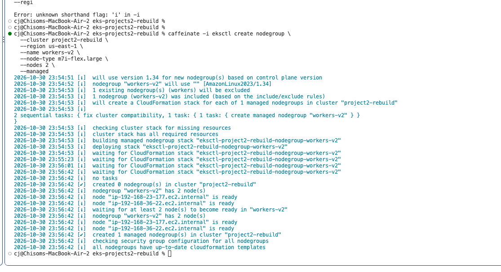

Connect kubectl to the cluster:

```bash
aws eks update-kubeconfig --name project2-rebuild --region us-east-1
kubectl get nodes
```

Both nodes showed `Ready`.

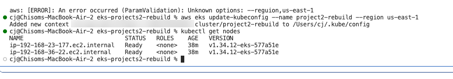

> **Why:** `update-kubeconfig` saves the cluster's address and credentials into `~/.kube/config` so `kubectl` knows which cluster to talk to.

---

## Section 2: Build and deploy the app with Helm

### 2.1 Create the chart

```bash
helm create my-microservice
```

This gives you:

```
my-microservice/
├── Chart.yaml      # chart name, version, and default app version
├── values.yaml     # the settings (the "answers")
└── templates/      # Kubernetes YAML with blanks (the "script")
```

**How Helm works, in one sentence:** Helm takes the templates, fills in the blanks using `values.yaml`, and sends the finished YAML to Kubernetes.

### 2.2 Prove it before deploying

`helm template` fills in the blanks and prints the result without sending anything to the cluster. I used it to check that the values flow into the templates:

```bash
$ grep replicaCount my-microservice/values.yaml
replicaCount: 1

$ helm template my-microservice ./my-microservice | grep replicas
  replicas: 1

$ helm template my-microservice ./my-microservice | grep image:
          image: "nginx:1.16.0"
      image: busybox
```

- `nginx:1.16.0`: `values.yaml` sets `repository: nginx` but leaves `tag: ""` empty, so Helm falls back to `appVersion: 1.16.0` from `Chart.yaml`.
- `busybox` comes from `templates/tests/test-connection.yaml`, a small test pod that only runs with `helm test`.

### 2.3 Install

```bash
helm install my-microservice ./my-microservice
kubectl get pods
```

```
NAME                               READY   STATUS    RESTARTS   AGE
my-microservice-68bf8d8dd7-pbcnh   1/1     Running   0          4m15s
```

### 2.4 Scale by hand and check high availability

I changed `replicaCount: 1` to `3` in `values.yaml`, then:

```bash
helm upgrade my-microservice ./my-microservice
kubectl get pods -o wide
```

| Pod | Node | Age |
|---|---|---|
| ...-8zzf7 | ip-192-168-36-22 | 29s |
| ...-fkhft | ip-192-168-23-177 | 29s |
| ...-pbcnh | ip-192-168-36-22 | 57m |

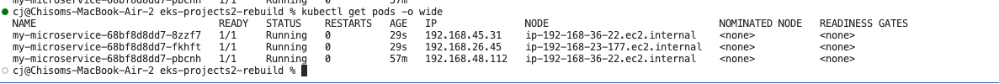

What I learned:

- **Nodes are not replicas.** Nodes are the machines. Replicas are copies of the app running on them.
- Kubernetes **spread the pods across both nodes** (2 and 1), so losing one node doesn't take the app down.
- The original pod (57m) was **kept**. Only the count changed, not the pod spec, so Kubernetes just added 2 more.
- `helm install` is for the first deploy. `helm upgrade` applies any change to a release that already exists.

### 2.5 Reach the app

```bash
kubectl get svc
```

```
NAME              TYPE        CLUSTER-IP      EXTERNAL-IP   PORT(S)
my-microservice   ClusterIP   10.100.66.103   <none>        80/TCP
```

Pod IPs change every time a pod is replaced. The **Service** gives a stable address in front of them. It's `ClusterIP`, which means internal only (`EXTERNAL-IP: <none>`), so I used a port-forward to reach it from my laptop:

```bash
kubectl port-forward svc/my-microservice 8080:80
# open http://localhost:8080
```

Request path: **Browser → localhost:8080 → tunnel → Service → one of the nginx pods**

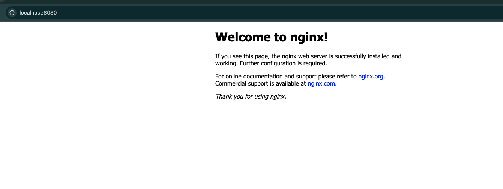

---

## Section 3: Autoscaling with the HPA

### 3.1 Install metrics-server

The HPA needs CPU numbers to make decisions. `kubectl top nodes` failed because metrics-server wasn't installed on the cluster.

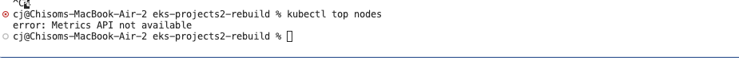

```bash
kubectl apply -f https://github.com/kubernetes-sigs/metrics-server/releases/latest/download/components.yaml
kubectl top nodes
```

```
NAME                             CPU(cores)   CPU(%)   MEMORY(bytes)   MEMORY(%)
ip-192-168-23-177.ec2.internal   31m          1%       494Mi           6%
ip-192-168-36-22.ec2.internal    16m          0%       490Mi           6%
```

### 3.2 Turn on autoscaling

In `values.yaml`:

```yaml
resources:
  requests:
    cpu: 50m

autoscaling:
  enabled: true
  minReplicas: 1
  maxReplicas: 5
  targetCPUUtilizationPercentage: 50
```

```bash
helm lint ./my-microservice
helm upgrade my-microservice ./my-microservice
kubectl get hpa
```

**Why `cpu: 50m` is required:** the HPA's 50% target is a percentage *of the pod's CPU request*. Without a request there's no baseline, so the HPA can't calculate a percentage. With `50m`, the HPA adds pods once a pod uses more than 25m.

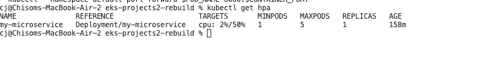

With no traffic, the HPA scaled the Deployment **down from 3 to 1** on its own.

### 3.3 Load test: watch it scale up

Terminal 1:

```bash
kubectl get hpa -w
```

Terminal 2:

```bash
kubectl run load-generator --image=busybox:1.36 --restart=Never -- /bin/sh -c "while true; do wget -q -O- http://my-microservice; done"
```

Result:

```
TARGETS        REPLICAS
cpu: 2%/50%    1
cpu: 36%/50%   1
cpu: 74%/50%   1    <- over target
cpu: 66%/50%   2    <- HPA adds a pod
cpu: 50%/50%   3    <- and another
cpu: 37%/50%   3    <- under target, holds steady
cpu: 36%/50%   3
```

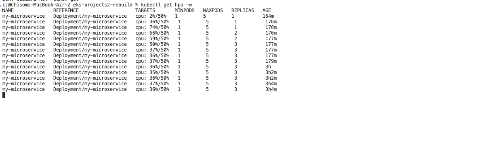

- As pods were added, **CPU per pod dropped** (74% on 1 pod became about 36% each on 3).
- It stopped at **3, not 5**. `maxReplicas` is a safety ceiling, not a target. The HPA only adds what it needs to get back under 50%.
- After I deleted the load generator, it scaled back down to 1.

---

## Errors I hit and how I fixed them

| # | Error | Cause | Fix |
|---|---|---|---|
| 1 | Original `workers` nodegroup (t3.medium) failed: `InvalidParameterCombination - The specified instance type is not eligible for Free Tier` | My account was on the free tier plan, which doesn't allow t3.medium | Listed allowed types with `aws ec2 describe-instance-types --filters Name=free-tier-eligible,Values=true`, then created `workers-v2` with `m7i-flex.large` |
| 2 | Several failed `eksctl create nodegroup` attempts | Multi-line command typos: `caffeniate` (misspelled), `-region` (one dash), `nodes 2` (missing `--`), `project2-rebuild\` (no space before `\`), and a space after `\` that broke the line continuation | Retyped carefully, one flag per line, `--` on every flag, nothing after the `\` |
| 3 | `aws: [ERROR] ... Unknown options: --regiuon` | Typo in the flag | Retyped as `--region` |
| 4 | Helm `path not found` | Misspelled the chart folder in `helm template` (the release name can be anything, but the chart path must match exactly) | Corrected the folder name |
| 5 | `kubectl top nodes` failed (Metrics API not available) | metrics-server isn't installed on EKS by default | Applied the metrics-server manifest |
| 6 | Terminal crashed mid-edit, leaving `values.yaml.save` and an empty `values.yml` | nano's emergency backup, plus a `.yml` vs `.yaml` typo that created a new blank file | Deleted the extras, redid the edits in `values.yaml` |
| 7 | HPA not scaling; `load-generator` in `Error` with `/bin/sh: illegal option -w` | No space between `-c` and the quote (`-c"while...`), so the shell read `-cwhile` as flags `-c` and `-w` | See below |

### Deep dive: "The autoscaler wasn't broken. The load source was."

The HPA showed `cpu: 2%/50%` and 1 replica the whole time I was "load testing." Instead of assuming the HPA was broken, I checked the thing feeding it:

1. `kubectl get pods`: `load-generator` was in `Error`, not `Running`.
2. `kubectl logs load-generator`: `/bin/sh: illegal option -w`
3. Rather than re-reading my own command, I checked **what Kubernetes actually received**:

   ```bash
   kubectl get pod load-generator -o jsonpath='{.spec.containers[0].args}'
   ```

   It showed `-cwhile` glued together. No space after `-c`.
   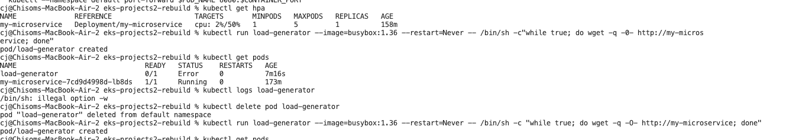

4. Fix: `kubectl delete pod load-generator` (pod names must be unique) and rerun with `-c "while ..."`.

**Lesson:** when autoscaling doesn't kick in, confirm the load is actually reaching the app first. Then read the logs, then check the pod's real spec.

---

## Teardown and cost check

Running cost was roughly **$8/day** (EKS control plane, 2 worker nodes, NAT gateway), about **$20** over the two days the cluster was up.

```bash
eksctl delete cluster --name project2-rebuild --region us-east-1
```

```bash
$ kubectl get pods
Unable to connect to the server: dial tcp: lookup <cluster-endpoint>: no such host

$ aws eks list-clusters --region us-east-1
{ "clusters": [] }

$ aws cloudformation list-stacks --region us-east-1 \
    --stack-status-filter DELETE_IN_PROGRESS DELETE_FAILED CREATE_COMPLETE \
    --query "StackSummaries[?contains(StackName, 'eksctl')].[StackName,StackStatus]" --output table
# (empty)

$ aws ec2 describe-nat-gateways --region us-east-1 \
    --filter Name=state,Values=available --query "NatGateways[].NatGatewayId"
[]
```

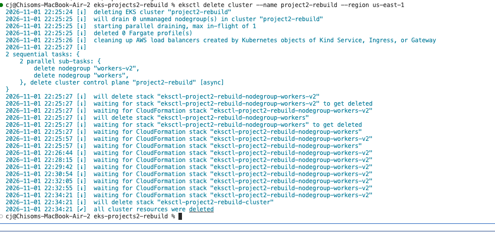

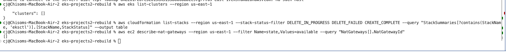

No clusters, no eksctl stacks, and no NAT gateways left, so nothing was still billing.

---

## What I'd add next (production-style upgrades)

- **A real multi-service app** instead of a single nginx image, so the "microservices" part holds up (for example, a frontend + API + database, each with its own chart or subchart)
- **Public access through an AWS Load Balancer Controller + Ingress** instead of a port-forward
- **Cluster Autoscaler or Karpenter**, so nodes scale with pods, not just pods on fixed nodes
- **CPU/memory limits and PodDisruptionBudgets** for safer scaling and node maintenance
- **Infrastructure as code (Terraform)** for the cluster, plus **GitOps (Argo CD)** for deploys
- **Monitoring** with Prometheus and Grafana dashboards for the HPA and pods
- **Budget alerts** in AWS Billing so a forgotten cluster can't run up a bill

---

## Conclusion

The goal of this rebuild wasn't just to get nginx running on EKS. It was to understand each piece well enough to explain it and fix it. The biggest takeaways for me:

1. Helm = templates + values. `helm template` lets you check the output before anything touches the cluster.
2. Nodes are machines, replicas are app copies, and Kubernetes spreads replicas out for availability.
3. Services give you a stable address while pods come and go.
4. The HPA needs metrics-server and a CPU request, and `maxReplicas` is a ceiling, not a goal.
5. When something "doesn't work," check what the system actually received before blaming the tool.
6. Always tear down and verify. Cloud bills don't stop on their own.
